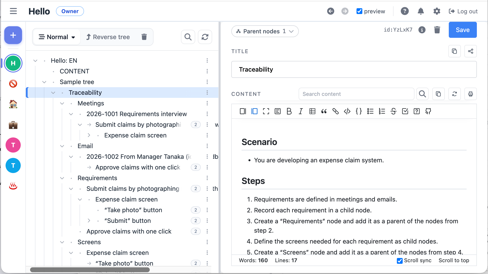

# zeetaweb

[English](README.md) | 日本語

[](https://mcpservers.org/servers/masa0703/zeetaweb_pub)

ノードを木構造（DAG: 1つのノードが複数の親を持てる）で整理する Web アウトラインエディタです。Cloudflare Pages / Workers / D1 / R2 / Workers AI / Vectorize の上で動きます。

**お試し:** https://zeetaweb.jp （無料のお試し版。Google / GitHub アカウントでログイン）



## 主な機能

- Google / GitHub アカウントでのログイン（OAuth）
- ツリーとノードの作成・編集・並び替え。1つのノードを複数の親に置ける（構造リンク／参照リンク）
- ノード本文の Markdown 表示、画像の添付（R2）、編集履歴と過去版への復元
- キーワード検索と、Workers AI + Vectorize によるベクトル検索（本番環境のみ）
- ツリーの共有（招待メール、閲覧者／編集者の権限）
- MCP サーバー（OAuth 認可）。Claude などの MCP クライアントからツリーを読み書きできる
- 日本語／英語 UI

## このリポジトリについて（必ずお読みください）

- **Cloudflare 専用です。** データベース（D1）、画像の保存先（R2）、検索（Workers AI / Vectorize）、ビルドとデプロイ（Pages / Wrangler）をすべて Cloudflare の機能で実装しています。ほかの環境（一般的なサーバー、AWS、Vercel など）では、作り直さない限り動きません。
- **無保証です。** MIT ライセンスのとおり、本ソフトウェアの利用によって生じたデータの破損・消失、サービスの停止などについて、作者は一切の責任を負いません。
- **作者が運用しているホスト版はお試し用です。** 継続的な利用やデータの保全は保証しません。使い続けたい場合は、このリポジトリを fork して自分の Cloudflare アカウントで動かしてください。
- **issue・pull request は受け付けていません。** 届いても対応せずに閉じることがあります。サポートも行いません。

## 必要なもの

- Node.js 22 以降
- Cloudflare アカウント（D1 / R2 / Pages。ベクトル検索を使うなら Workers AI / Vectorize）
- Google と GitHub の OAuth アプリ
- 招待メールを送るなら Mailgun（未設定なら送信をスキップするだけで、他の機能は動きます）

## セットアップ

### 1. 依存関係と設定ファイル

```bash
npm install

cp wrangler.toml.example wrangler.toml
cp wrangler.local.toml.example wrangler.local.toml
cp .dev.vars.example .dev.vars
```

`wrangler.toml` / `wrangler.local.toml` / `.dev.vars` は `.gitignore` 済みです。コミットしないでください。

### 2. Cloudflare リソースの作成

```bash
# D1（ローカル開発用・本番用・ステージング用）
npx wrangler d1 create zeeta2-production
npx wrangler d1 create your-app-production --location apac
npx wrangler d1 create your-app-staging --location apac

# R2（通常用・プレビュー用）
npx wrangler r2 bucket create your-app-images
npx wrangler r2 bucket create your-app-images-preview

# Vectorize（@cf/baai/bge-m3 の出力次元に合わせる）
npx wrangler vectorize create your-app-prod --dimensions 1024 --metric cosine
npx wrangler vectorize create your-app-dev --dimensions 1024 --metric cosine
```

作成したリソースの名前と、D1 作成時に表示される `database_id` を、`wrangler.toml` と `wrangler.local.toml` のプレースホルダ（`<...>`）に書き込みます。

- ローカル用の npm スクリプト（`db:migrate:local` / `db:seed` / `dev:sandbox` など）は、ローカル D1 の名前を `zeeta2-production` 固定で参照します。トップレベルの `[[d1_databases]]` の `database_name` は `zeeta2-production` にしてください。
- 本番用のスクリプト（`db:migrate:prod` / `db:console:prod`）は binding 名 `DB` と `--env production` で `[env.production]` の D1 を参照します。
- Pages のプロジェクト名は `wrangler.toml` の `name` が使われます。

### 3. 環境変数（`.dev.vars`）

| 変数 | 用途 |
| --- | --- |
| `JWT_SECRET` | セッション用 JWT の署名鍵。32 文字以上のランダム値（例: `openssl rand -base64 48`） |
| `GOOGLE_CLIENT_ID` / `GOOGLE_CLIENT_SECRET` | Google OAuth。リダイレクト URI は `<APP_URL>/auth/callback/google` |
| `GITHUB_CLIENT_ID` / `GITHUB_CLIENT_SECRET` | GitHub OAuth。コールバック URL は `<APP_URL>/auth/callback/github` |
| `APP_URL` | アプリの URL。ローカルでは `http://localhost:3000` |
| `ENABLE_TEST_ENDPOINTS` | `true` のとき、ローカルに限りテスト用ログイン（`/auth/test-login`）を有効にする。**本番では設定しない** |
| `MAILGUN_API_KEY` / `MAILGUN_DOMAIN` | 招待メールの送信。未設定なら送信をスキップする |

本番では同じ変数を Cloudflare Pages の環境変数（シークレット）として設定します（`ENABLE_TEST_ENDPOINTS` を除く）。

### 4. ローカルで起動

```bash
npm run db:reset      # ローカル D1 を作り直して migration と seed を適用
npm run build
npm run dev:sandbox   # http://localhost:3000
```

- ブラウザでは `127.0.0.1` ではなく **`localhost`** を使ってください。OAuth の state クッキーがホスト名で分かれるため、`127.0.0.1` ではログインに失敗します。
- テスト用ログイン: `http://localhost:3000/auth/test-login?user_id=1`
- **dev サーバーの起動中に `npm run db:reset` を実行しないでください。** 起動中のプロセスが参照している DB ファイルが消え、DB を使う API がすべて 500 になります。止めてからリセットし、起動し直します。

### 5. テスト

```bash
npx playwright test tests/<file>.spec.js   # E2E（dev サーバーは自動で起動）
npm run test:node                          # Node のユニットテスト
```

### 6. 本番デプロイ

```bash
npm run build
npm run db:migrate:prod
node scripts/deploy-pages.js
```

## 技術スタック

- バックエンド: Hono（Cloudflare Pages Functions / Workers）、TypeScript
- データ: Cloudflare D1（SQLite）、R2（画像）、Workers AI + Vectorize（ベクトル検索）
- フロントエンド: Vanilla JavaScript
- ビルド: Vite、Wrangler
- テスト: Playwright、Node.js test runner

## ライセンス

[MIT](LICENSE) © masa0703

`public/static/vendor/` 以下の第三者の素材は、それぞれ同梱のライセンスに従います。
