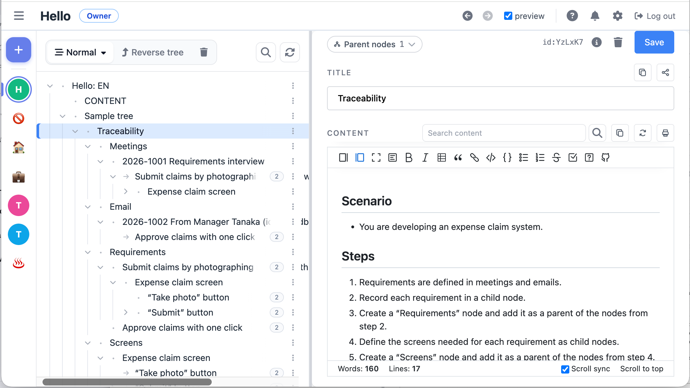

# zeetaweb

English | [日本語](README.ja.md)

[](https://mcpservers.org/servers/masa0703/zeetaweb_pub)

A web outline editor that organizes nodes as a tree in which a node can have multiple parents (a DAG). It runs on Cloudflare Pages / Workers / D1 / R2 / Workers AI / Vectorize.

**Try it:** https://zeetaweb.jp (free trial; sign in with Google or GitHub)



## Features

- Sign in with a Google or GitHub account (OAuth)
- Create, edit and reorder trees and nodes. A single node can sit under multiple parents (structural links / reference links)
- Markdown rendering of node content, image attachments (R2), edit history and restoring past versions
- Keyword search and vector search with Workers AI + Vectorize (production only)
- Tree sharing (email invitations, viewer / editor roles)
- MCP server (OAuth authorization). MCP clients such as Claude can read and write your trees
- Japanese / English UI

## About this repository (please read)

- **Cloudflare only.** The database (D1), image storage (R2), search (Workers AI / Vectorize), and build and deploy (Pages / Wrangler) are all implemented with Cloudflare features. It will not run in other environments (a typical server, AWS, Vercel, etc.) without being rewritten.
- **No warranty.** As stated in the MIT License, the author accepts no liability for data corruption or loss, service outages, or anything else arising from use of this software.
- **The hosted version run by the author is a trial.** Continued availability and data preservation are not guaranteed. If you want to keep using it, fork this repository and run it on your own Cloudflare account.
- **Issues and pull requests are not accepted.** They may be closed without a response. No support is provided.

## Requirements

- Node.js 22 or later
- A Cloudflare account (D1 / R2 / Pages; Workers AI / Vectorize for vector search)
- Google and GitHub OAuth apps
- Mailgun, if you want to send invitation emails (if unset, sending is skipped and everything else still works)

## Setup

### 1. Dependencies and config files

```bash
npm install

cp wrangler.toml.example wrangler.toml
cp wrangler.local.toml.example wrangler.local.toml
cp .dev.vars.example .dev.vars
```

`wrangler.toml` / `wrangler.local.toml` / `.dev.vars` are in `.gitignore`. Do not commit them.

### 2. Create Cloudflare resources

```bash
# D1 (local development, production, staging)
npx wrangler d1 create zeeta2-production
npx wrangler d1 create your-app-production --location apac
npx wrangler d1 create your-app-staging --location apac

# R2 (regular and preview)
npx wrangler r2 bucket create your-app-images
npx wrangler r2 bucket create your-app-images-preview

# Vectorize (matches the output dimensions of @cf/baai/bge-m3)
npx wrangler vectorize create your-app-prod --dimensions 1024 --metric cosine
npx wrangler vectorize create your-app-dev --dimensions 1024 --metric cosine
```

Write the names of the resources you created, and the `database_id` shown when each D1 database is created, into the placeholders (`<...>`) in `wrangler.toml` and `wrangler.local.toml`.

- The local npm scripts (`db:migrate:local` / `db:seed` / `dev:sandbox`, etc.) refer to the local D1 by the fixed name `zeeta2-production`. Set `database_name` in the top-level `[[d1_databases]]` to `zeeta2-production`.
- The production scripts (`db:migrate:prod` / `db:console:prod`) refer to the D1 in `[env.production]` through the binding name `DB` and `--env production`.
- The Pages project name is taken from `name` in `wrangler.toml`.

### 3. Environment variables (`.dev.vars`)

| Variable | Purpose |
| --- | --- |
| `JWT_SECRET` | Signing key for session JWTs. A random value of 32 or more characters (e.g. `openssl rand -base64 48`) |
| `GOOGLE_CLIENT_ID` / `GOOGLE_CLIENT_SECRET` | Google OAuth. The redirect URI is `<APP_URL>/auth/callback/google` |
| `GITHUB_CLIENT_ID` / `GITHUB_CLIENT_SECRET` | GitHub OAuth. The callback URL is `<APP_URL>/auth/callback/github` |
| `APP_URL` | The app's URL. `http://localhost:3000` for local development |
| `ENABLE_TEST_ENDPOINTS` | When `true`, enables the test login (`/auth/test-login`), locally only. **Do not set it in production** |
| `MAILGUN_API_KEY` / `MAILGUN_DOMAIN` | Sending invitation emails. If unset, sending is skipped |

In production, set the same variables as Cloudflare Pages environment variables (secrets), except `ENABLE_TEST_ENDPOINTS`.

### 4. Run locally

```bash
npm run db:reset      # Recreate the local D1 and apply migrations and seed data
npm run build
npm run dev:sandbox   # http://localhost:3000
```

- In the browser, use **`localhost`**, not `127.0.0.1`. The OAuth state cookie is scoped by host name, so signing in fails on `127.0.0.1`.
- Test login: `http://localhost:3000/auth/test-login?user_id=1`
- **Do not run `npm run db:reset` while the dev server is running.** The DB file the running process uses is deleted, and every API that touches the DB returns 500. Stop the server, reset, then start it again.

### 5. Tests

```bash
npx playwright test tests/<file>.spec.js   # E2E (starts the dev server automatically)
npm run test:node                          # Node unit tests
```

### 6. Deploy to production

```bash
npm run build
npm run db:migrate:prod
node scripts/deploy-pages.js
```

## Tech stack

- Backend: Hono (Cloudflare Pages Functions / Workers), TypeScript
- Data: Cloudflare D1 (SQLite), R2 (images), Workers AI + Vectorize (vector search)
- Frontend: Vanilla JavaScript
- Build: Vite, Wrangler
- Tests: Playwright, Node.js test runner

## License

[MIT](LICENSE) © masa0703

Third-party assets under `public/static/vendor/` are subject to their own bundled licenses.
